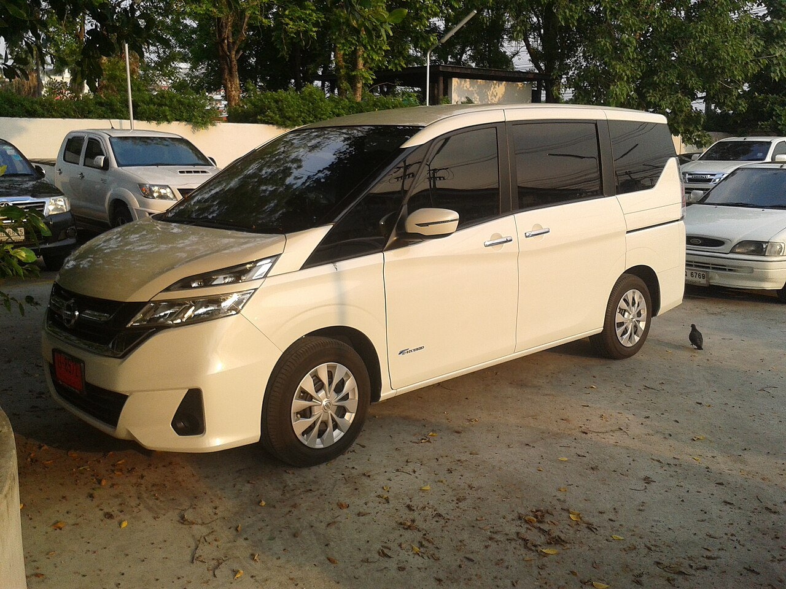

# Error Analysis — ชุดทดสอบ 50 รูป

สรุปจากการรัน `src/train/evaluate_test_set.py` กับโมเดล `models/best.pt` (fold 3, mAP@0.5 CV = 0.995)

## ผลรวม

| ตัวชี้วัด | ค่า |
|---|---|
| Precision | 0.988 |
| Recall | 0.940 |
| mAP@0.5 | 0.954 |
| อัตราครอปสำเร็จ (IoU ≥ 0.5) | **49/50 = 98.0%** |

## กรณีที่พลาด (1 จาก 50 รูป)

### `plate_110.jpg` — ไม่พบป้ายทะเบียนเลย

**สาเหตุที่น่าจะเป็นไปได้:**

1. **ป้ายแดง (ป้ายทะเบียนชั่วคราว/เต็นท์รถ)** — ในชุดข้อมูลเทรน 200 รูป มีป้ายแดงอยู่น้อยมากเทียบกับป้ายขาวมาตรฐาน ทำให้โมเดลไม่คุ้นกับลักษณะสีป้ายแบบนี้
2. **มุมถ่ายเฉียง 3/4** — ไม่ใช่มุมหน้าตรง/หลังตรงที่เงื่อนไขโครงงานกำหนด ทำให้รูปทรงสี่เหลี่ยมของป้ายบิดเบี้ยวจากมุมมองปกติ
3. **แสงพลบค่ำ** — ความสว่างต่ำ สีแดงของป้ายกลืนกับโทนสีโดยรวมของภาพ (อาจรวมถึงกันชนสีแดง/สนิมด้านหน้ารถด้วย) ทำให้ contrast ระหว่างป้ายกับพื้นหลังต่ำ

**ข้อเสนอแนะสำหรับพัฒนาต่อ:**
- เพิ่มตัวอย่างป้ายแดงในชุดเทรนให้มากขึ้น (ปัจจุบันมีสัดส่วนน้อย)
- เพิ่มตัวอย่างรูปที่ถ่ายในแสงน้อย/พลบค่ำ
- พิจารณาเพิ่ม data augmentation ด้านความสว่าง (brightness) ระหว่างเทรนให้มากขึ้น

## สรุป

อัตราครอปสำเร็จ 98% ถือว่าสูงมากสำหรับข้อมูลเทรนเพียง 200 รูป ข้อผิดพลาดที่พบมีสาเหตุชัดเจนและสอดคล้องกับข้อจำกัดที่ระบุไว้ในรายงาน (รองรับเฉพาะรูปหน้าตรง/หลังตรง ไม่ครอบคลุมป้ายแดง/แสงน้อย) ไม่ใช่ความผิดปกติของโมเดลที่อธิบายไม่ได้
